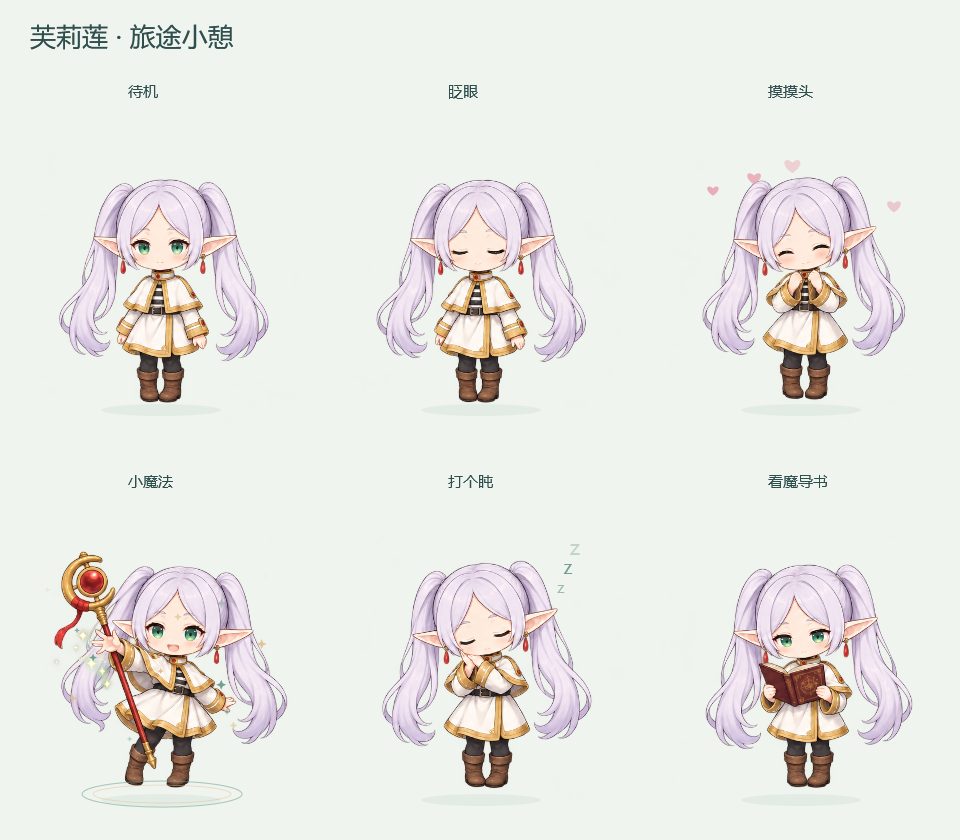

<div align="center">

# 芙莉莲 · 旅途小憩

**一个安静的 Windows 透明桌宠**

她会待在屏幕右下角，轻轻呼吸、偶尔眨眼，<br>
过一会儿自己翻翻魔导书，或者打个盹。你摸她一下，她会脸红。




</div>

---

## ✨ 简介

双击 `Frieren.exe` 就能用。不需要安装 Python、Node 或任何运行时，不需要联网，不需要 API Key——程序只用 Windows 自带的 .NET Framework 4.8。

角色图集以资源形式内嵌在 exe 里，动画全部由代码实时绘制。没有网络请求，没有屏幕读取，没有聊天服务，没有声音。

## 🎬 她会做什么

| 状态 | 触发方式 | 表现 |
| :--- | :--- | :--- |
| **待机** | 默认 | 柔和的呼吸起伏，身体轻微摇摆，地面有一圈会呼吸的影子 |
| **眨眼** | 自动，每 2.5–5.5 秒 | 自然的一次闭眼 |
| **看书** | 自动，每 24–44 秒 | 捧着深红魔导书低头阅读 |
| **打盹** | 自动，每 24–44 秒 | 手靠近脸颊，头顶飘出 sleep 的 `z` |
| **摸摸头** | 单击 / 右键菜单 | 开心表情、脸颊泛红，飘出小爱心 |
| **小魔法** | 双击 / 右键菜单 | 挥动法杖，脚下展开光环，升起青绿与金色的星点 |

自动行为不会打断你正在做的事——所有状态切换都只发生在固定尺寸的窗口内部，**窗口位置永远不会自己变化**。

## 🚀 快速开始

**方式一：直接下载（推荐）**

从 [Releases](../../releases) 或直接下载仓库里的 `Frieren.exe`，双击运行即可。

**方式二：从源码构建**

需要 Windows 自带的 .NET Framework 4.x（Win10/11 默认已有）：

```powershell
powershell -NoProfile -ExecutionPolicy Bypass -File .\build.ps1
```

脚本调用系统的 `csc.exe`，把图集编进 exe，产物为 `Frieren.exe`。

> 如果正在运行桌宠，请先通过右键菜单退出，再重新构建。

## 🖱️ 交互

| 操作 | 效果 |
| :--- | :--- |
| **按住左键拖动** | 把她移到屏幕任意位置，松开后自动记住 |
| **单击** | 摸摸头 |
| **双击** | 挥动法杖施法 |
| **右键** | 打开菜单 |
| **托盘图标** | 右键显示/隐藏或退出，双击找回隐藏的角色 |

拖动不会误触发摸头或施法——程序用系统双击时间和拖动阈值做了区分，拖回原处也不算点击。

**右键菜单**可以：摸摸头 · 施个小魔法 · 打个盹 · 看魔导书 · 切换三档大小（小巧 / 标准 / 大一点）· 保持置顶 · 暂停动画 · 暂时隐藏 · 回到右下角 · 退出。

### 一些细节

- 窗口默认置顶，可在右键菜单里取消
- **透明处可以点到下方的应用**，点角色本身也不会抢走你正在输入的应用的键盘焦点（`MA_NOACTIVATE` + 逐像素命中测试）
- 重新启动会恢复上次拖动的位置；屏幕布局改变（接投影、改分辨率）时会把角色放回可见的工作区
- 支持负坐标，多显示器也能正确收回
- 位置、大小、置顶偏好保存在同目录的 `settings.json`，配置文件只读也能以内存偏好正常运行
- 重复启动不会出现第二只桌宠（互斥体保护）
- 程序异常会在同目录生成 `error.log`

**找不到她了？** 看系统托盘的隐藏图标区，双击芙莉莲图标即可恢复。

## 📁 项目结构

```
Frieren.exe                  可直接运行，角色图集已内嵌
assets/
  frieren-atlas.png          六种状态的透明原始图集（3×2）
  frieren.ico                应用图标
  generation-prompt.txt      素材生成时使用的提示词与修正过程
src/
  Frieren.cs                 窗口、动画状态机、交互、自检（单文件）
  app.manifest               兼容性与 DPI 清单
build.ps1                    使用系统 C# 编译器构建
tests/
  preview.png                六种状态的实际程序渲染
  self-test.txt              自检结果
  interaction.log            交互诊断记录样例
ART-NOTES.txt                素材制作说明与参考链接
README.txt                   随文件夹分发的离线说明书
```

## 🔧 技术细节

**动画状态机与帧率无关。** `PetModel.Tick(dt)` 接收时间增量，定时器以 24fps 驱动重绘，但状态推进按真实时间计算，卡顿也不会让动画变快变慢。

**逐像素命中测试。** `PetSurface` 重写 `HitTestCore`，从图集对应的帧里采样 alpha 通道（阈值 24）。点透明区域时窗口返回 `HTTRANSPARENT`，鼠标事件直接穿透到下方窗口；点身体时才响应。命中测试会先反向应用身体变换矩阵，所以呼吸和抖动时的判定依然精确。

**表现层是程序化绘制。** 图集只提供六张角色姿势，呼吸缩放、摇摆旋转、受击弹跳、爱心、魔法星点、`z` 字母、气泡对话框全部由 `DrawingContext` 实时绘制：

- 爱心与星点用 `StreamGeometry` + 贝塞尔曲线构造
- 魔法光环是两层椭圆，透明度按正弦脉动
- 粒子按黄金角 `i * 2.399` 分布，避免聚集
- 受击弹跳带 `Exp(-t * 0.6)` 阻尼衰减

**空域与多显示器。** 位置换算始终在工作区（`WorkingArea`，即任务栏之上）坐标系里进行，取窗口所在那块屏幕的工作区，设备坐标与 WPF 逻辑坐标通过 `CompositionTarget.TransformFromDevice` 转换。

**渲染策略。** 透明小窗口用 `RenderMode.SoftwareOnly`，避免为它建立庞大的 Direct3D 渲染缓存。

## ✅ 自检

```powershell
.\Frieren.exe --self-test .\tests
```

会校验图集透明度、动画生命周期、拖动与点击的区分、抓取偏移、屏幕边界收回、三档尺寸锚定、负坐标、新旧配置兼容与位置保存往返，并重新渲染 `tests/preview.png`。

需要记录真实交互位置时：

```powershell
.\Frieren.exe --diagnostics .\tests\interaction.log
```

## ❓ 常见问题

<details>
<summary><b>双击没反应 / 单击变成了双击？</b></summary>

程序遵循系统的双击时间设置。单击后会等待系统的双击识别时间再响应摸头，所以手感略有一点延迟——这是为了让你双击施法时不误触发摸头。
</details>

<details>
<summary><b>她挡住我的操作了</b></summary>

透明的地方可以直接点穿过去。如果还嫌挡路，右键菜单里可以「暂时隐藏」，或者把她拖到别处，也可以取消置顶。
</details>

<details>
<summary><b>能开机自启吗？</b></summary>

没有内置自启。需要的话，把 `Frieren.exe` 的快捷方式放进 `shell:startup` 文件夹即可。
</details>

<details>
<summary><b>会联网吗？会上传我的数据吗？</b></summary>

不会。程序没有任何网络代码，唯一的磁盘读写是同目录的 `settings.json`（偏好）和需要时的 `error.log`（诊断）。
</details>

## 🎨 制作说明

角色由内置图像生成工具绘制，**不是**从现有桌宠或游戏里提取的素材。六格图集（待机 / 眨眼 / 开心 / 魔法 / 打盹 / 看书）在内存中用 WPF `CroppedBitmap` 切片，运行时无任何网络访问。

动作是程序化 2D，不是 Live2D 骨骼，也不是 3D 模型。

美术方向、参考链接与生成提示词见 [`ART-NOTES.txt`](ART-NOTES.txt) 和 [`assets/generation-prompt.txt`](assets/generation-prompt.txt)。

## 📜 声明

这是《葬送的芙莉莲》的**非官方个人同人二次创作**，与原作者及版权方无关，未获其授权或认可。角色「芙莉莲」及相关设定的权利归原作者与版权方所有。

仅供个人学习与欣赏，请勿用于商业用途。

---

<details>
<summary><b>English summary</b></summary>

**Frieren · Quiet Corner** — a quiet transparent desktop pet for Windows.

Double-click `Frieren.exe` and she lives in the corner of your screen: breathing, blinking, occasionally reading a grimoire or dozing off. Drag her anywhere, single-click to pat her head, double-click to cast a small spell, right-click for the menu.

- **Zero dependencies** — runs on the built-in .NET Framework 4.8; no Python, no Node, no API key, no internet
- **Per-pixel hit testing** — clicks pass through transparent areas to whatever is behind her, and she never steals keyboard focus
- **Procedural motion** — the atlas holds six poses; breathing, sway, bounce, hearts, magic particles and speech bubbles are all drawn in code
- **Never wanders** — she only moves when you drag her, and remembers where you left her
- Single-file C# / WPF source in `src/Frieren.cs`, built with `build.ps1`

Unofficial fan work. "Frieren: Beyond Journey's End" and its characters belong to their respective rights holders. Personal and non-commercial use only.

</details>
